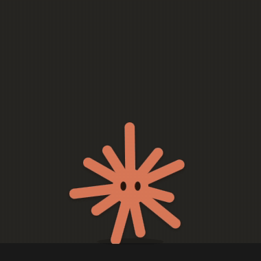
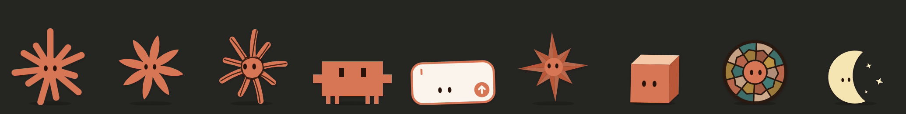
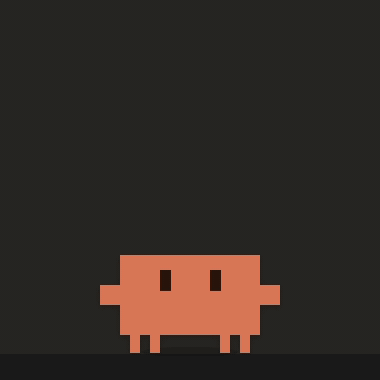
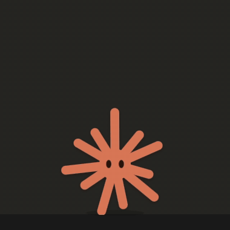

# Clawdkin

**A little Claude that lives on your taskbar and shows what Claude Code is doing.** It works when Claude works, hops and waves when Claude needs you, and gets up to mischief in between.

<p align="center"></p>

Hover over it and a thought cloud tells you what Claude is up to: the file it is editing, the command it is running, and the task you gave it. When Claude needs your OK or has a question, it hops and holds up a `!` (or `?`), so you can leave a long task running and notice the moment it needs you, without watching the terminal.

> Clawdkin is an unofficial fan project. It is not made by, affiliated with or endorsed by Anthropic. Claude and Clawd belong to Anthropic.

## Install

You need [Node.js](https://nodejs.org) 22.12 or newer (the current LTS is fine) and [Claude Code](https://docs.claude.com/en/docs/claude-code/overview).

```bash
git clone https://github.com/0HBrar0/clawdkin.git
cd clawdkin
npm install
npm run setup
npm start
```

`npm run setup` adds Clawdkin's hooks to `~/.claude/settings.json` (it merges with what is there and saves a backup first). The first `npm start` downloads Electron (about 100 MB), so it takes a minute and needs a connection. Then start a **new** Claude Code session: hooks only load in sessions started after setup.

On Windows you can start it later without a console window by double-clicking `start-clawdkin.vbs`, and **Start with Windows** (right-click → More) keeps it around.

Something not working? Run `npm run doctor`. It checks Node, Electron, the hooks and the data folder, and says what to fix.

## What it shows

| Claude is… | Clawdkin… |
|---|---|
| idle | breathes, blinks, looks around, follows your mouse with its eyes |
| working | does its own working animation, and holds a prop for the tool in use: a magnifier for reading, a pencil for editing, a terminal for commands, a globe for the web |
| waiting for you | hops and holds up `!` for a permission request, `?` for a question, `✓` for a plan to review |
| done | twirls, with sparkles |
| quiet for a while | naps |

It also sweats on long turns, winces when a tool fails, keels over when tests fail, and leaves a little paper scrap for every file Claude edits (swept away when the turn ends). With several sessions running, each one orbits it as a dot.

## Forms

<p align="center"></p>

It slowly evolves through the shapes Claude takes, flowing from one into the next. Spark, Glyph (the ✻ spinner), Doodle and Clawd are there from the start. The rest are earned by using Claude: **Prompt** (30 tool calls), **Origami** (5 finished tasks), **Blocky** (3 projects), **Stained glass** (3 days), **Night** (working after 10pm). You can pin one form, or unlock them all from its card.

## Things to do with it

<p align="center"> </p>

- **Click it** to open Claude (the desktop app if you have it, claude.ai otherwise).
- **Drag it** anywhere; it snaps to screen edges. **Fling it** and it bounces off the edges and lands dizzy.
- **Pet it** by rubbing the mouse back and forth over it.
- **Feed it** a file by dropping it on it: it eats the file, copies the path, and opens Claude so you can paste it in.
- **Middle-click** for a trick (spin, backflip, juggle, sneeze, sing, moonwalk, a confetti ta-da, heart eyes, a code sprint and more). It also does them on its own when idle; *Silliness* sets how often.
- **Play catch**: a 20-second game where you slide it under falling sparks.
- **Read its diary**: a hand-written page about your day together, with a sticker for every project it has seen.
- **Right-click** for its card: what Claude is doing right now, a big Open Claude button, one-tap tiles for a trick, catch, the diary, a new form and hiding for 30 minutes, plus tabs for looks, play, habits and more. Keys 1 to 5 switch tabs, Esc closes it.
- **Ctrl + scroll** to resize it (50% to 200%).

### On the taskbar (Windows)

Now and then it wanders along the taskbar, and sometimes gets up to something:

- **Hide an app**: hops down in front of one of your running apps, whistles innocently, peeks to see if you noticed, then steps aside: ta-da.
- **Taskbar shark**: dives into the taskbar and glides along with only the top of its head showing.
- **Hopscotch** across your app icons, **push** the Start button with all its might, **nap** in front of the clock, **guard** the Claude icon.
- **Oops**: leans on Start a bit too hard and the Start menu really opens. It panics, closes it, and whistles.
- **Peek**: tugs open the hidden-icons tray, has a look, and tucks it away again.

Move the mouse near it while it is in front of the taskbar and it squeaks and scurries off, so it never stands between you and an app. It skips tricks while something is full screen. The two that press real buttons only happen on their own after 30 seconds with no keyboard or mouse input, only close what they opened, and can be switched off ("Let it press Start and the hidden icons").

### Quick reply (experimental, off by default)

Turn it on in the card (right-click → More), and when Claude asks for permission or asks a question, click Clawdkin to answer right there: Allow / Deny, or pick an option. While it is on, Claude waits for your answer on Clawdkin first (20 seconds by default), and then falls back to its own prompt. You can only *allow* what the card shows in full (a command or a web address); for file edits it sends you to Claude, which shows the diff. An answer always goes to the exact request on the card, even if another session asks something meanwhile.

## Privacy and safety

- **Nothing leaves your computer.** Clawdkin makes no network requests and has no telemetry. The hook writes small files to `~/.clawdkin` and the app reads them.
- **What the hook records:** each session's state, the current tool and what it works on (a file *name*, a command's description or its first few words, a site's *hostname*), the first 90 characters of your latest prompt (shown in the thought cloud), and counters for the diary. It never stores file contents, and drops anything after an `=` in a command (so `TOKEN=…` stays out). The one exception is a pending permission request: its command is kept until the request is answered, so Quick reply can show you exactly what you would approve.
- **The hooks never get in Claude's way.** They run in the background, and any error falls through to Claude's normal flow. The two Quick reply hooks return immediately unless Quick reply is on and Clawdkin is running.
- **Clipboard:** "lean in when I copy something" compares a fingerprint of the clipboard; the text is never stored. You can switch it off.
- **Taskbar:** it reads where the taskbar buttons are (positions only, via UI Automation). Only the *Oops* and *Peek* tricks press anything, as described above.

## Platforms

| | Windows 10/11 | macOS | Linux |
|---|---|---|---|
| Status, forms, tricks, games, diary, Quick reply | ✓ | ✓ | ✓ |
| Start with Windows (card toggle) | ✓ | – | – |
| Wander along the bottom of the screen | ✓ | ✓ | ✓ |
| Taskbar tricks, perching on windows | ✓ | – | – |
| Opens the Claude desktop app on click | ✓ | ✓ | claude.ai |

It is developed and tested on Windows 11. macOS and Linux should work but have had less testing; reports are very welcome. Linux needs a compositor for the transparent window.

## Uninstall

```bash
npm run uninstall-hooks
```

Then quit Clawdkin (right-click → Quit, bottom of the card) and delete the folder, and `~/.clawdkin` if you don't want to keep its memory. The backup of your settings from setup is at `~/.claude/settings.json.clawdkin-backup`.

## Troubleshooting

- **It never changes state.** Start a *new* Claude Code session after `npm run setup`, then run `npm run doctor`.
- **"Electron failed to install correctly"** on the first `npm start`: check `node -v` is 22.12 or newer, then delete `node_modules` and run `npm install` and `npm start` again. Behind a proxy, see [Electron's install docs](https://www.electronjs.org/docs/latest/tutorial/installation).
- **I only want it for one project.** `node install-hooks.js --project path/to/project` writes the hooks to that project's `.claude/settings.local.json` instead.
- **I moved the folder, or reinstalled or switched Node** (nvm, fnm, volta). The hooks point at the Node that ran setup, so run `npm run setup` again; it replaces the old entries. `npm run doctor` spots this.
- **It is in the way.** Drag it somewhere else, make it smaller with Ctrl + scroll, or right-click → Hide 30 min.

## How it works

```
Claude Code ──hooks──▶ hook.js ──▶ ~/.clawdkin/state/<session>.json ──▶ Clawdkin (Electron)
                                   ~/.clawdkin/events.log            ──▶ memory, diary, unlocks
```

- `hook.js`: the Claude Code hook. One small process per event writes the session's state; it exits immediately.
- `main.js`: the always-on-top transparent window, state and memory, dragging, throwing, wandering, the popup cards. `taskbar.js` does the taskbar tricks.
- `renderer/`: the character. One animation loop blends motion between states; `forms/` are the shapes, `antics.js` the tricks, `reactions.js` its reactions, `taskbar-antics.js` the taskbar poses, `thought.js` the thought cloud, `extras.js` props, hats and moods.
- `settings/`, `diary/`, `reply/`: the small windows.
- `tools/*.ps1`: Windows helpers (taskbar layout, pressing Start, the active window for perching).

## Development

```bash
npm test          # hook, installer and file checks (no Electron needed)
npm run preview   # the character in a browser: http://127.0.0.1:5251/dev/gallery.html
```

Set `CLAWDKIN_DEBUG` to `windows`, `motion`, `game`, `look`, `walk`, `tb`, `poke`, `thought` or `menu` before `npm start` to run a self-check that saves snapshots to `~/.clawdkin/debug` (PowerShell: `$env:CLAWDKIN_DEBUG='windows'; npm start`, bash: `CLAWDKIN_DEBUG=windows npm start`). `CLAWDKIN_HOME` moves the data folder. `dev/make-media.ps1` rebuilds the GIFs in `docs/`, and `dev/bench.ps1` measures CPU and memory per state (idle, working, waiting) on a separate test copy. On Windows Clawdkin draws without the GPU process; `CLAWDKIN_GPU=1` turns it back on.

Issues and pull requests are welcome. Please include the output of `npm run doctor` with bug reports, and `~/.clawdkin/errors.log` if it exists (errors from the app and its windows end up there).

## License

[MIT](LICENSE). Clawdkin is an unofficial fan project and is not affiliated with Anthropic.
